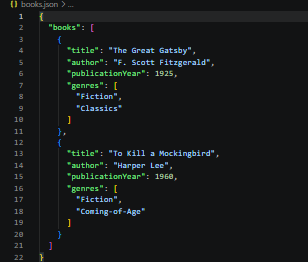
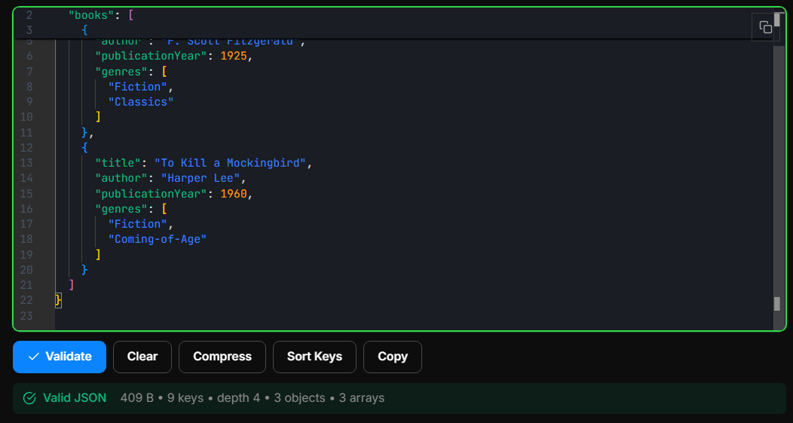
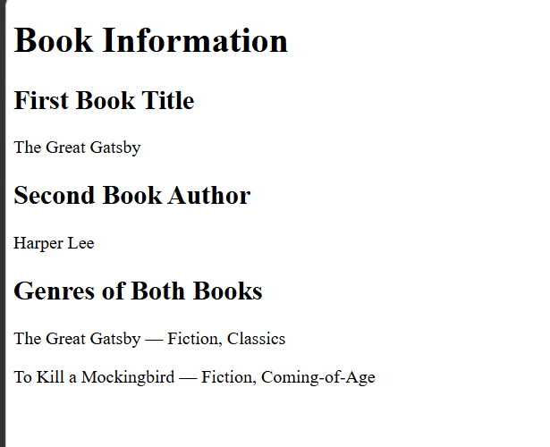
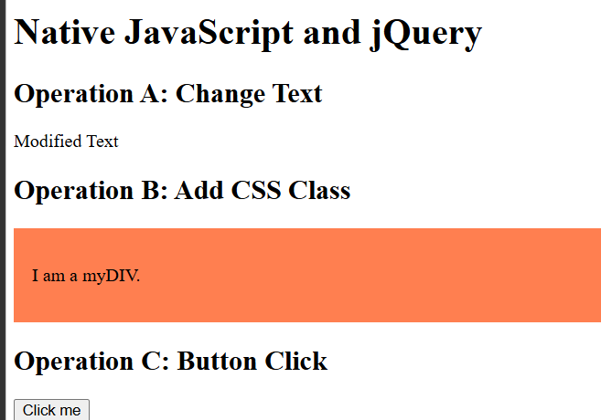
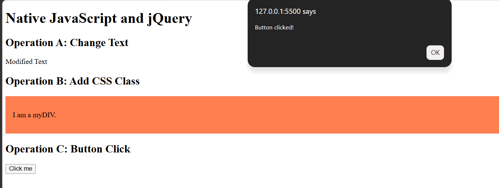

# BIC21203 Web Development — Lab 4b

## Client-Side Scripting: JSON and jQuery

**Name:** Mohamad Fauzan Fikri Bin Mohamad Zamri  
**Matric Number:** AI250135    
**Course:** BIC21203 Web Development

---

## 1. Introduction

This lab focuses on using JSON, modern JavaScript, and jQuery in web development. The activities involve creating structured JSON data, retrieving and displaying data on a webpage using the `fetch()` API, and performing DOM manipulation and event handling using jQuery.

## 2. Question 1: Create and Structure JSON Data

The `books.json` file contains information about two books. Each book object includes its title, author, publication year, and genres.

The data uses a top-level `books` array containing two objects. Strings use double quotation marks, publication years are stored as numbers, and genres are stored as arrays of strings.

**Expected data:**
- *The Great Gatsby* — F. Scott Fitzgerald, 1925
- *To Kill a Mockingbird* — Harper Lee, 1960

**Evidence:** See `ss_books_json.png` and `ss_books_validate.png`.

## 3. Question 2: Retrieve and Display JSON Data

The `books.html` file uses JavaScript's `fetch()` API to retrieve data from `books.json`. The program uses `async/await` to handle asynchronous operations and `response.json()` to parse the JSON data.

The webpage displays:
- The title of the first book.
- The author of the second book.
- The genres of both books, grouped by book title.

The program also uses error handling to display a user-friendly message if the request fails or the JSON data is invalid.

**Expected output:**
- The Great Gatsby
- Harper Lee
- The Great Gatsby — Fiction, Classics
- To Kill a Mockingbird — Fiction, Coming-of-Age

**Evidence:** See `ss_books.png`.

## 4. Question 3: Compare Native JavaScript and jQuery

1. **Change text:** The `.text()` method changes "Original Text" to "Modified Text".
2. **Add a CSS class:** The `.addClass()` method applies the `myStyle` class to `#myDIV`, giving it a coral background and 16-pixel padding.
3. **Handle a button click:** The `.on("click", ...)` method displays an alert containing "Button clicked!".

Native JavaScript does not require an external library, while jQuery offers concise methods for DOM manipulation and event handling. Existing projects may continue using jQuery when their code already depends on it.

**Evidence:** See `ss_output.png` and `ss_output_button.png`.

## 5. How to Run the Project

### Requirements
- Visual Studio Code or another code editor.
- A modern web browser.
- The Live Server extension for Visual Studio Code.
- An internet connection for loading jQuery from the CDN.

### Run Question 1
1. Open `books.json` in the code editor.
2. Check that the JSON structure is correct.
3. Validate the JSON using [JSONLint](https://jsonlint.com/).

### Run Question 2
1. Open the project folder in Visual Studio Code.
2. Ensure `books.json` and `books.html` are in the same folder.
3. Right-click `books.html`.
4. Select **Open with Live Server**.
5. Check that all required book information appears in the browser.

### Run Question 3
1. Open `jquery-dom.html` in Visual Studio Code.
2. Right-click the file and select **Open with Live Server**.
3. Verify that the text changes to "Modified Text".
4. Verify that the second element has a coral background and padding.
5. Click the button and check that the alert appears.

## 6. Reflection

Through this lab, I learned how to create and structure JSON data, retrieve data using JavaScript's `fetch()` API, and display information dynamically on a webpage. I also gained a better understanding of error handling and how to manipulate HTML elements using jQuery. By comparing native JavaScript with jQuery, I learned that both can perform DOM manipulation and event handling, but jQuery provides simpler syntax for certain operations. Overall, this lab improved my understanding of client-side scripting and how JSON and jQuery can be used in web development.
